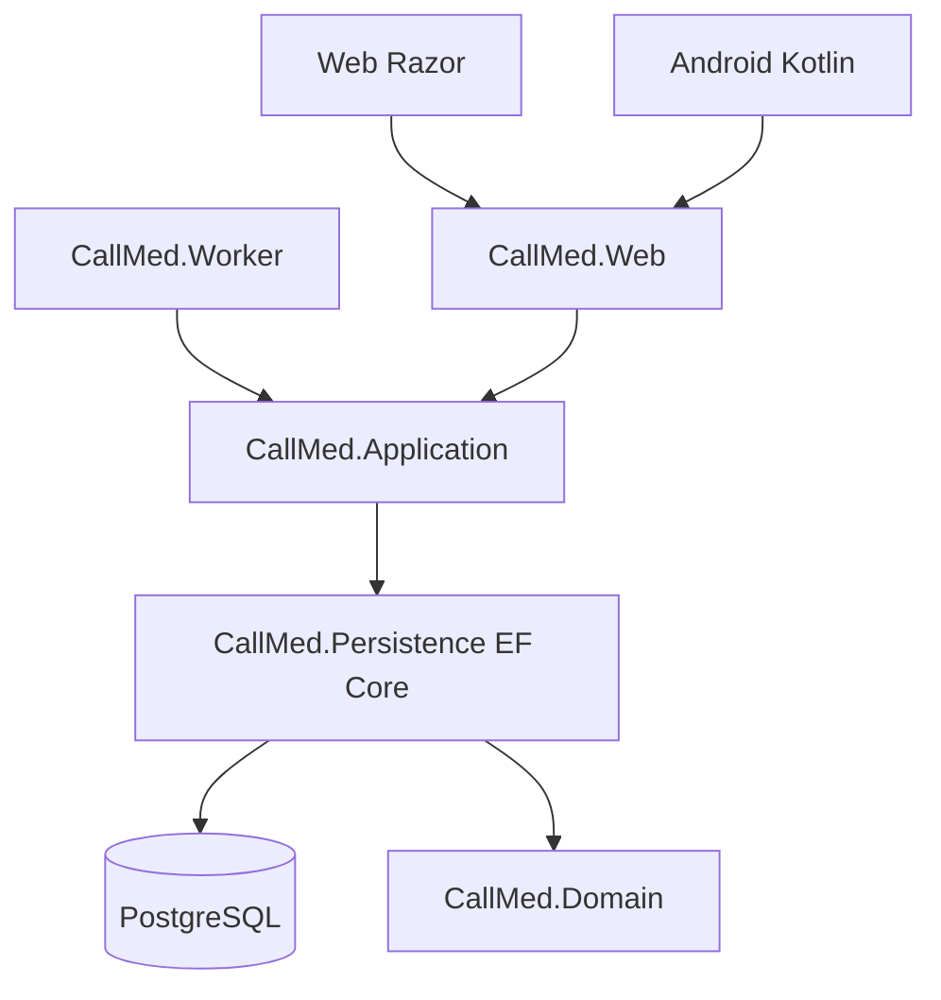
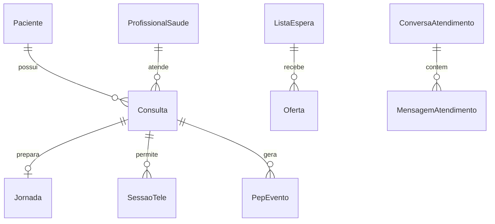
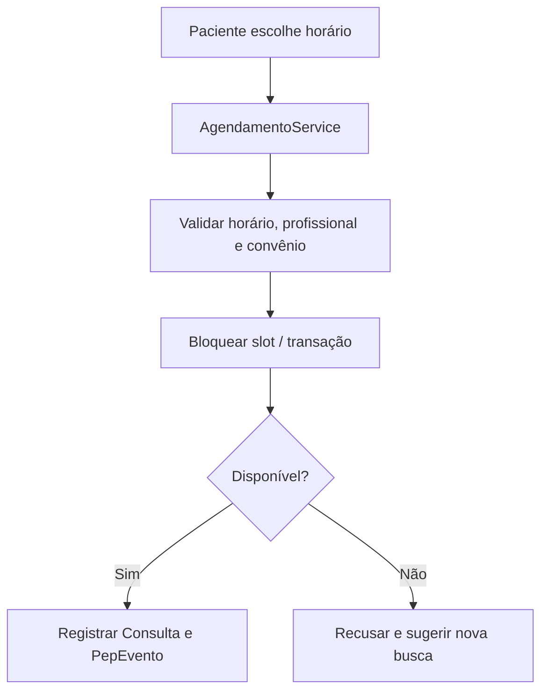
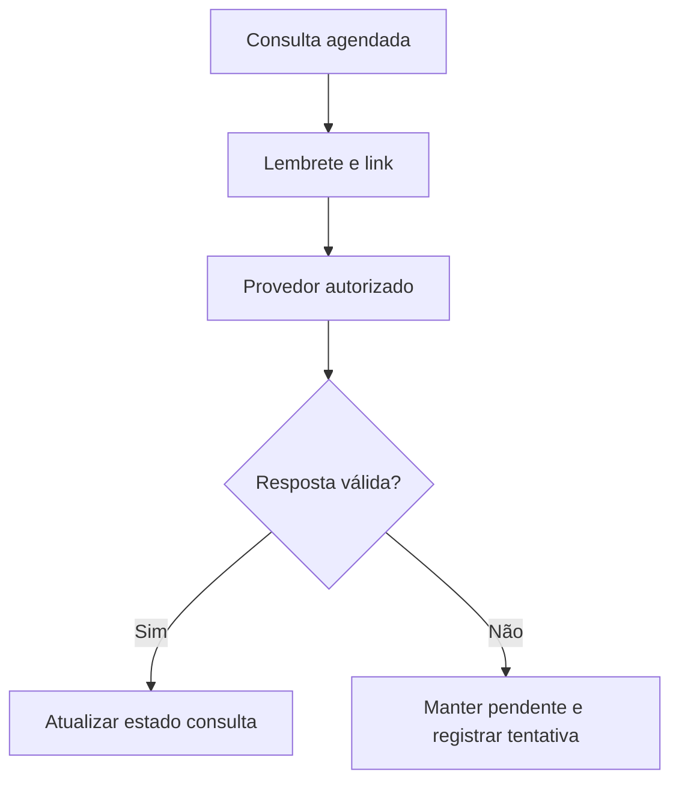
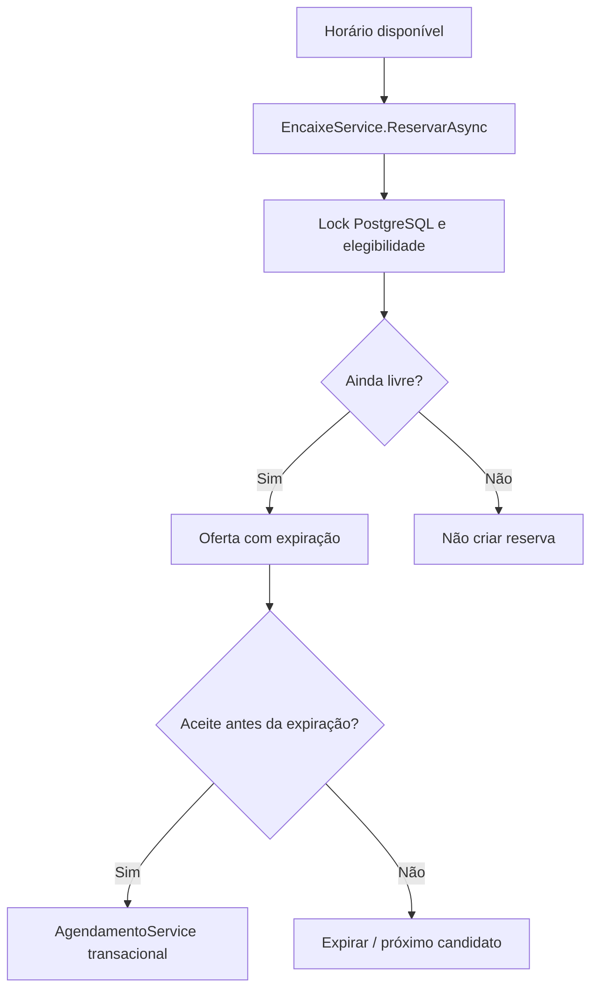
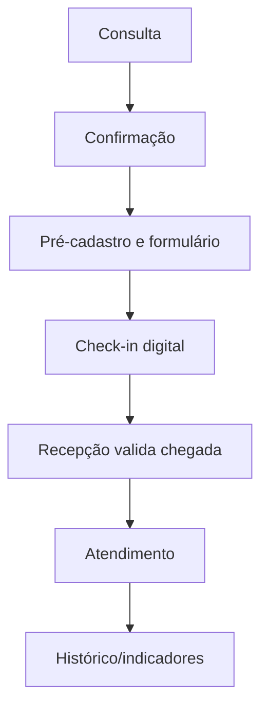
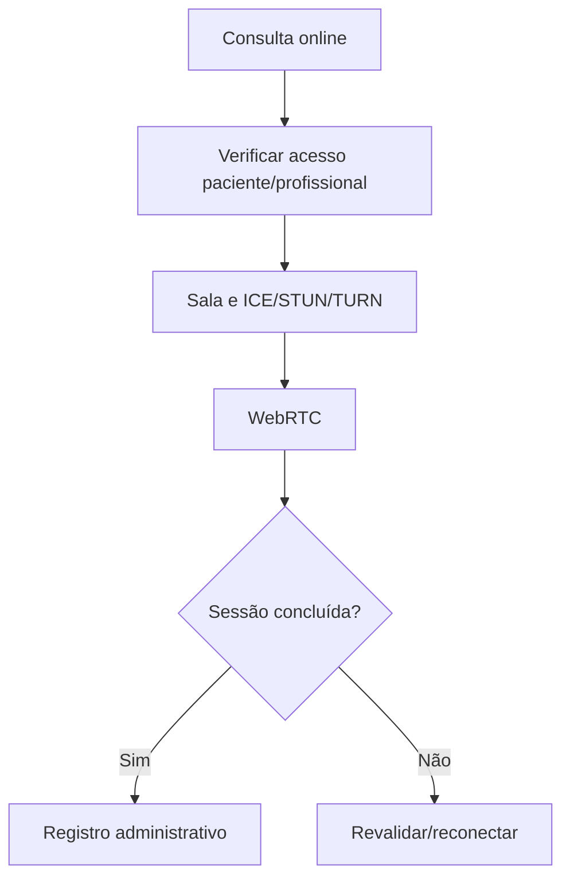
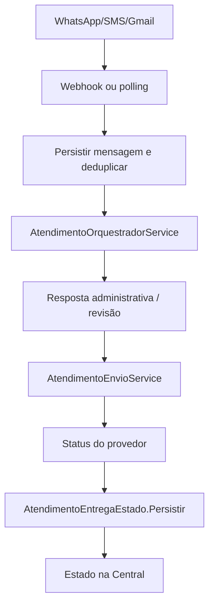

# Diagramas de dependências e fluxos (baseados em código localizado)

Estes diagramas são o mapa **inicial** dos fluxos. As arestas de negócio ainda requerem validação de execução. A única trilha corrigida foi envio IA → persistência do estado.

## 1. Arquitetura

## 2. Relações de dados (resumo)

## 3. Agendamento

## 4. Confirmação multicanal

## 5. Encaixe inteligente

## 6. Jornada do paciente

## 7. Teleconsulta

## 8. Atendimento e IA

