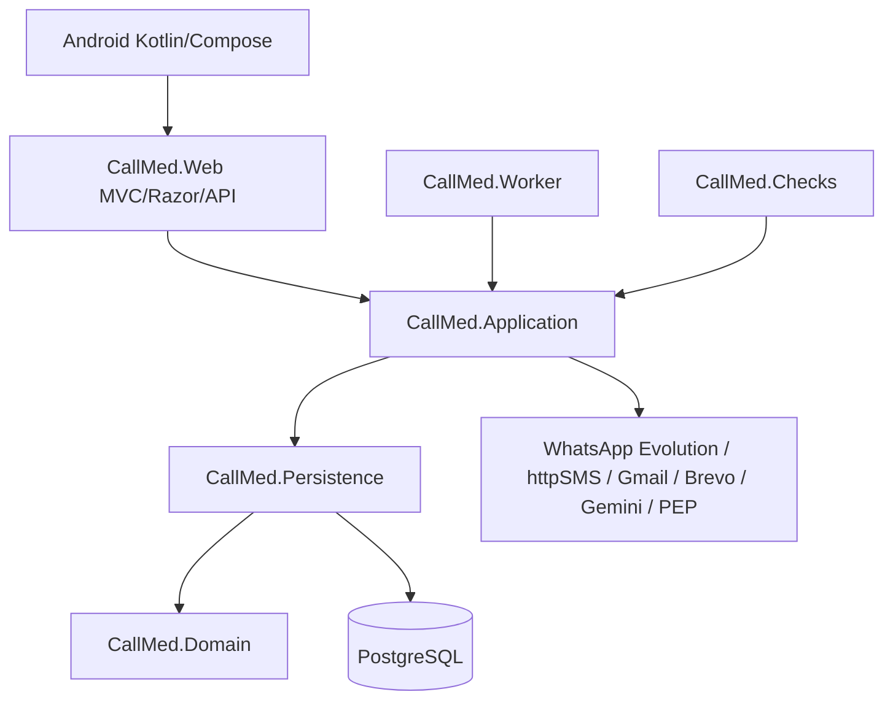

# Dependências verificadas pelos `.csproj`

Fonte: extração XML dos 6 arquivos `.csproj` da V54.1.

| Projeto | Target | Dependências internas |
|---|---|---|
| `src/CallMed.Application/CallMed.Application.csproj` | net10.0 | ../CallMed.Persistence/CallMed.Persistence.csproj |
| `src/CallMed.Domain/CallMed.Domain.csproj` | net10.0 | nenhuma |
| `src/CallMed.Persistence/CallMed.Persistence.csproj` | net10.0 | ../CallMed.Domain/CallMed.Domain.csproj |
| `src/CallMed.Web/CallMed.Web.csproj` | net10.0 | ../CallMed.Application/CallMed.Application.csproj |
| `src/CallMed.Worker/CallMed.Worker.csproj` | net10.0 | ../CallMed.Application/CallMed.Application.csproj |
| `tests/CallMed.Checks/CallMed.Checks.csproj` | net10.0 | ../../src/CallMed.Web/CallMed.Web.csproj |

Os fluxos externos são conexões de alto nível inferidas dos serviços/integrações encontrados; só as arestas entre projetos foram verificadas automaticamente nos arquivos de projeto. Um relacionamento no desenho não implica testes bem-sucedidos de rede.
