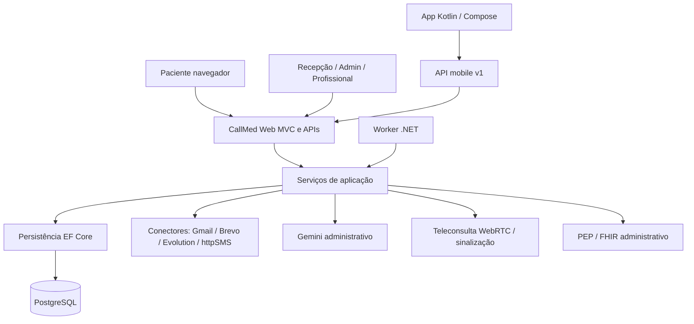
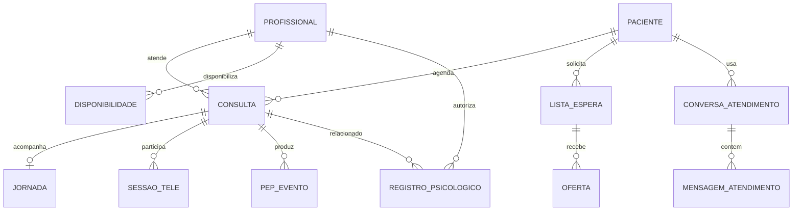
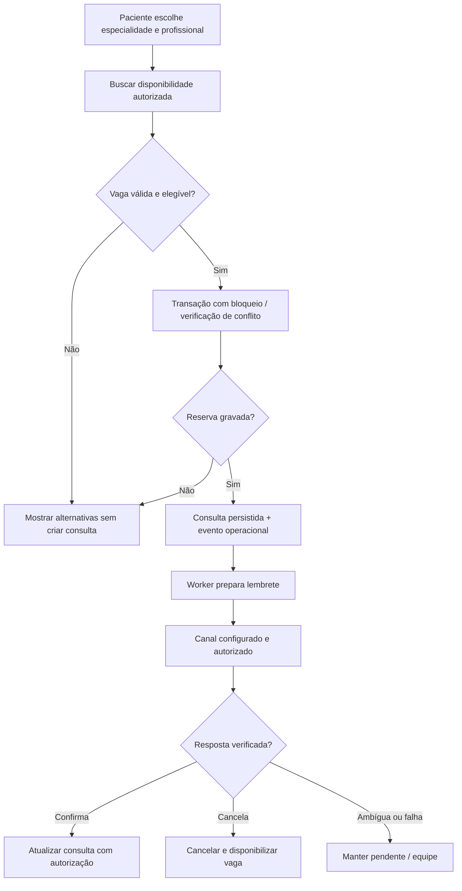
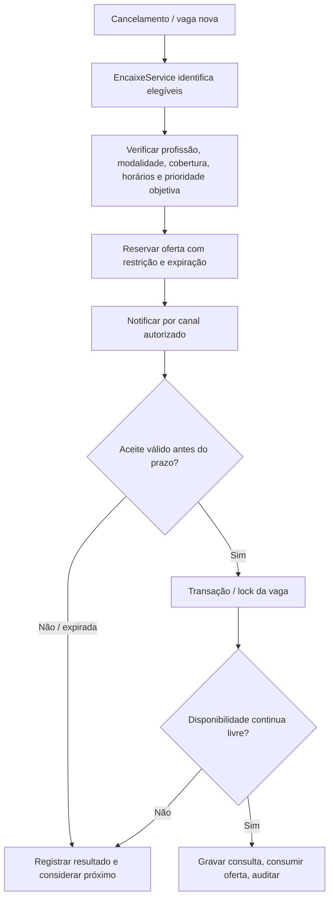
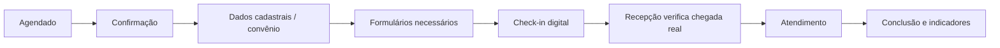
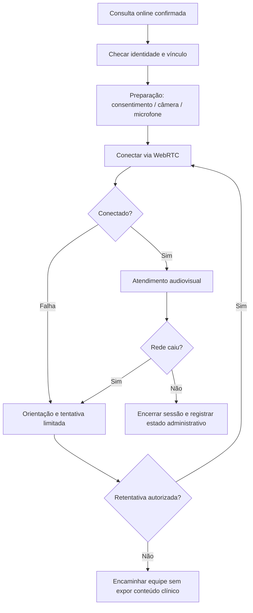
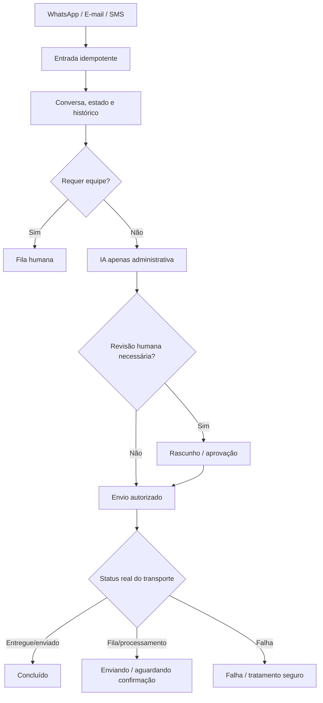
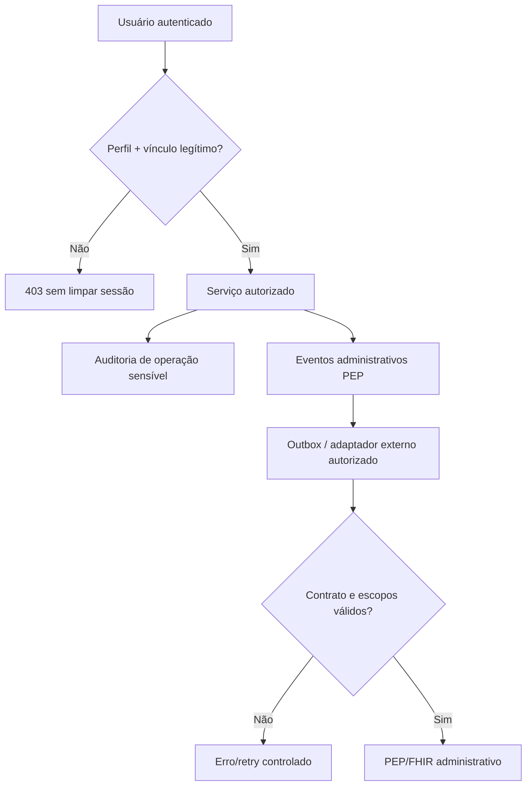

# Arquitetura técnica e diagramas de fluxo — CallMed V54.1 NEXT

## Decisão arquitetural

Preservar o monólito modular .NET 10, PostgreSQL/EF Core, Razor e o app Kotlin/Jetpack Compose. A base **V54.1** utiliza `src/CallMed.Web`, `src/CallMed.Application`, `src/CallMed.Domain`, `src/CallMed.Persistence`, `src/CallMed.Worker`, `mobile/android`. Os namespaces `MKSANCrud` são herança e **não devem ser renomeados sem migração planejada**. A arquitetura já possui locks PostgreSQL/índice único no domínio da agenda e métodos específicos de canais.

- **Apresentação:** controllers com autorização, Razor e APIs mobile; JS sem regras de elegibilidade clínicas próprias.
- **Aplicação:** agenda, encaixe, consultas, jornada, atendimento, IA, teleconsulta, integração e métricas.
- **Persistência:** `MKSANContext`, migrations existentes, Identity, auditoria e eventos PEP.
- **Worker:** rotinas recorrentes com idempotência/retentativas, compartilhando serviços de domínio com a Web.
- **Android nativo:** autentica e usa `/api/mobile/v1`; não acessa PostgreSQL diretamente.

## 1. Arquitetura geral

## 2. Entidade-relacionamento conceitual (subconjunto, não DDL)

*O desenho representa entidades relacionadas existentes; não substitui o mapeamento completo do EF (46 declarações DbSet, incluindo aliases; não são necessariamente 46 tabelas). Verificar nomes de FK e cardinalidades no `MKSANContext.cs` antes de qualquer alteração de esquema.*

## 3. Agendamento e confirmação

## 4. Encaixe inteligente por oferta temporária

*A presença de índice único `Oferta(MedicoId, Data, Horario)` para ofertas abertas e locks não substitui teste de concorrência com PostgreSQL. Nunca usar LLM para escolher prioridade clínica.*

## 5. Jornada do paciente e check-in

*Check-in digital não é prova automática de presença física.*

## 6. Teleconsulta e perdas de conexão

*Não há promessa de gravação automática nem de E2EE universal sem comprovação técnica.*

## 7. Atendimento multicanal e IA

**Correção desta entrega:** `AtendimentoEntregaEstado` centraliza a correspondência entre status de transporte e `IaEstado`; a tela da Central privilegia o status persistido da mensagem.

## 8. Privacidade e integração com prontuários

Esta integração **não** é uma sincronização clínica universal de prontuários. Uma evolução multiempresa exige modelo de isolamento completo e testes antes de ativar tenants.

## Principais decisões de evolução

1. Não modificar tabelas nem migrations nesta rodada; manter rollback de código isolado.
2. Estados de entrega definidos no backend e confirmados pelo canal; frontend só apresenta o estado.
3. HTTP 401 expira sessão; HTTP 403 nega a operação preservando identidade (a API de refresh pode encerrar sessão em resposta de refresh inválido).
4. Manter invariantes clínicos no domínio, independentemente do canal ou aplicativo.
5. Priorizar testes PostgreSQL reais de concorrência antes de refatorar os locks existentes.
