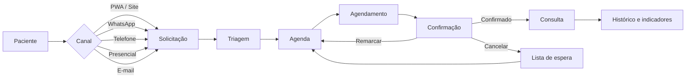
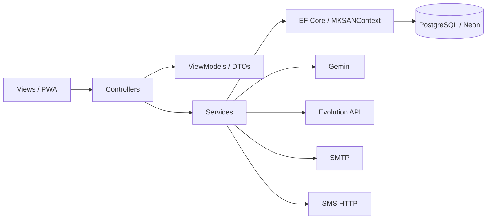

<p align="center">
  
</p>

<h1 align="center">CallMed</h1>

> **Perfis de acesso:** áreas de Paciente, Médico, Atendente/Recepcionista e Administrador. As contas da equipe são criadas pela administração; o atendente usa o papel interno `Funcionario` para manter compatibilidade com o banco. [Como usar e verificar os acessos](docs/ACESSOS-DA-EQUIPE.md).
>
> **Atendimento WhatsApp:** tratamento de HTTP 429, reenvio controlado e prevenção de avisos automáticos duplicados. [Correção, configuração e atualização do banco](docs/CORRECAO-ENVIO-WHATSAPP.md).
>
> **Identidade visual atual:** CSS centralizado em um único arquivo (`CallMedCrud/wwwroot/css/callmed.css`), com temas claro e escuro em índigo, safira e lavanda. A base contém 73 views MVC, 7 páginas Identity e páginas próprias de contingência/offline. [Redesign visual](docs/REDESIGN-VISUAL-2026-10-29.md) · [Compatibilidade e correções de 30/10](CallMedCrud/docs/CORRECAO-COMPATIBILIDADE-VISUAL-2026-10-30.md).
>
> **Segurança de exames:** o atalho “Meus exames” identifica o paciente pela conta autenticada; o acesso ao histórico de outras pessoas permanece restrito.
>
> **Recursos operacionais:** cadastro presencial sem e-mail, fila offline protegida, reconciliação com triagem, orientações e comprovante, histórico de exames e diagnóstico da Evolution API.
>
> **Matriz de convênios:** cobertura por convênio/produto e especialidade, sinalização de autorização prévia, pendências de conferência e registro auditável da decisão da equipe. A matriz interna não substitui a verificação individual na operadora. [Fluxo e homologação](docs/FLUXO-MATRIZ-CONVENIOS-ANS.md).
>
> [Entrega e atualização do banco](docs/ENTREGA-V22.md) · [Evolution no próprio projeto](docs/integracoes/EVOLUTION-NO-PROPRIO-PROJETO.md) · [Roteiro de homologação](docs/ROTEIRO-HOMOLOGACAO-V22.md) · [Validação](docs/validacao/VALIDACAO-V22.md)


<p align="center">
  <strong>Todos os canais. Uma única agenda.</strong>
</p>

<p align="center">
  Plataforma omnichannel para centralizar solicitações, triagem, agendamento, confirmações e atendimento de uma clínica em um único fluxo.
</p>

<p align="center">
  
  
  
  
  
  
</p>

<p align="center">
  <a href="https://callmed.onrender.com/"><strong>🌐 Acessar aplicação</strong></a>
  &nbsp;•&nbsp;
  <a href="./docs/ARQUITETURA.md">Arquitetura</a>
  &nbsp;•&nbsp;
  <a href="./docs/DESAFIO-SENAI.md">Desafio SENAI</a>
  &nbsp;•&nbsp;
  <a href="./docs/validacao/VALIDACAO.md">Validação</a>
</p>


---

## Sobre a CallMed

A **CallMed** é uma plataforma web de gestão e marcação de consultas criada para reduzir a fragmentação entre recepção, telefone, WhatsApp, e-mail e canais digitais.

Em vez de cada canal funcionar como um processo separado, a CallMed transforma o atendimento em um fluxo único:

**solicitação → triagem → disponibilidade → agendamento → confirmação → acompanhamento**

A proposta é apoiar a equipe da clínica, reduzir tarefas repetitivas e oferecer ao paciente uma experiência simples e acessível — sem eliminar o atendimento humano, telefônico ou presencial.

> **Objetivo:** tornar o processo de marcação de consultas mais rápido, acessível, padronizado e conectado.

---

## O problema que o projeto resolve

| Cenário comum | Como a CallMed responde |
|---|---|
| Solicitações espalhadas em vários canais | Centraliza tudo em um fluxo de atendimento |
| Demora para encontrar horários | Consulta disponibilidade real da agenda |
| Informações diferentes entre atendentes | Padroniza triagem, status e regras |
| Esquecimento de consultas | Trabalha com confirmações e lembretes |
| Vagas perdidas após cancelamentos | Utiliza lista de espera |
| Dificuldade de uso por alguns pacientes | PWA responsiva e recursos de acessibilidade |
| Retrabalho da recepção | Automatiza tarefas operacionais e oferece apoio por IA |
| Sistemas existentes isolados | Disponibiliza API de integração legada |

---

## Principais recursos

| | | |
|---|---|---|
| **📅 Agenda inteligente**<br>Agenda semanal, sessões, disponibilidade, exceções e prevenção de conflitos. | **💬 Atendimento omnichannel**<br>Web/PWA, WhatsApp, e-mail, SMS e registro de telefone/presencial. | **🤖 Assistente com IA**<br>Gemini conectado às informações reais do sistema para apoiar o atendimento. |
| **🩺 Gestão de consultas**<br>Agendamento, confirmação, remarcação, cancelamento e histórico. | **🔁 Lista de espera**<br>Ajuda a reaproveitar vagas liberadas e reduz horários ociosos. | **✅ Triagem administrativa**<br>Paciente, convênio, especialidade, preferências e elegibilidade. |
| **♿ Acessibilidade**<br>Modo Fácil, texto ampliado, alto contraste e interface mobile-first. | **📊 Indicadores e auditoria**<br>Acompanhamento operacional, rastreabilidade e eventos administrativos. | **🔌 Integrações**<br>Evolution API, SMTP, SMS HTTP, webhooks e API para sistemas legados. |

---

## Fluxo de atendimento



---

## Perfis do sistema

| Perfil | Principais recursos |
|---|---|
| **Paciente** | Agendar, consultar, confirmar, remarcar/cancelar quando permitido, lista de espera, conta e assistente |
| **Médico** | Painel e agenda relacionados ao atendimento médico |
| **Atendente / Recepcionista** | Pacientes, médicos, agenda, triagem, consultas, Central de Atendimento e relatórios. Papel interno no Identity: `Funcionario`. |
| **Administrador** | Recursos administrativos, funcionários, convênios, especialidades, integrações, auditoria e configurações |

A autorização é validada no servidor com **ASP.NET Core Identity + Roles**.

---

## Arquitetura

A aplicação é organizada para separar responsabilidades e manter o projeto simples de entender e evoluir.



### Organização das camadas

```text
CallMed/
├── CallMedCrud/
│   ├── Areas/Identity/          # Login, cadastro e recuperação
│   ├── Controllers/             # Entrada HTTP/MVC por domínio
│   ├── Data/                    # DbContext, Identity e configurações EF
│   ├── DTOs/                    # Contratos de APIs e integrações
│   ├── Extensions/              # DI, pipeline e endpoints
│   ├── Middleware/              # Middlewares próprios
│   ├── Migrations/              # Migrations do Entity Framework
│   ├── Models/                  # Entidades, enums e constantes
│   ├── Options/                 # Configurações tipadas
│   ├── Services/                # Regras de negócio e integrações
│   ├── ViewModels/              # Modelos específicos das telas
│   ├── Views/                   # Razor Views
│   └── wwwroot/                 # CSS, JS, PWA, imagens e ícones
│
├── CallMedTWA/                  # Aplicativo Android via TWA
├── PlayStore/                   # Materiais de publicação
├── docs/                        # Documentação técnica e validação
├── tests/                       # Verificações .NET e testes da contingência
│   ├── CallMed.Checks/           # Verificações executáveis do projeto
│   ├── contingencia-dom.mjs      # Testes DOM da fila offline
│   └── contingencia-browser.cjs  # Testes de navegador com Playwright
├── scripts/                     # Scripts auxiliares
├── .github/workflows/            # Automação de build/publicação
├── .env.example                 # Modelo de configuração (sem segredos)
├── compose.evolution.yml        # Ambiente auxiliar da Evolution API
├── Dockerfile
└── CallMed.sln
```

Para detalhes, consulte **[docs/ARQUITETURA.md](./docs/ARQUITETURA.md)**.

---

## Tecnologias

| Área | Tecnologia |
|---|---|
| Backend | .NET 8 / ASP.NET Core MVC |
| ORM | Entity Framework Core 8 |
| Banco | PostgreSQL / Neon |
| Autenticação | ASP.NET Core Identity + Roles |
| Front-end | Razor, HTML, CSS e JavaScript |
| PWA | Web App Manifest + Service Worker |
| Android | Trusted Web Activity (TWA) |
| IA | Google Gemini |
| WhatsApp | Evolution API |
| E-mail | SMTP + webhook inbound opcional |
| SMS | Gateway HTTP configurável |
| Container | Docker |
| Deploy | Render |

---

## Banco de dados

O projeto utiliza `MKSANContext`, baseado em `IdentityDbContext`, com provider **Npgsql** para PostgreSQL.

Entre as principais entidades estão:

`Paciente` · `Medico` · `Funcionario` · `Especialidade` · `Consulta` · `Disponibilidade` · `MedicoHorarioSemanal` · `ListaEspera` · `AgendaExcecao` · `SolicitacaoAtendimento` · `ConvenioEspecialidade` · `AuditoriaEvento` · `ConversaAtendimento` · `MensagemAtendimento`

Os mapeamentos do Entity Framework ficam separados em:

```text
CallMedCrud/Data/Configurations/
```

---

## Assistente com IA

A CallMed utiliza **Google Gemini** como apoio ao atendimento administrativo.

O agente pode consultar ferramentas internas para trabalhar com dados reais do sistema, por exemplo:

- médicos cadastrados;
- próximas vagas;
- horários disponíveis;
- consultas do paciente;
- confirmação e cancelamento;
- remarcação;
- lista de espera;
- informações oficiais da clínica.

> **Princípio:** a IA pode ajudar a consultar e conduzir o fluxo, mas não deve inventar médicos, horários, elegibilidade ou disponibilidade.

A IA é um recurso administrativo e **não substitui avaliação médica nem realiza diagnóstico**.

---

## Central de Atendimento

A Central reúne conversas e contexto do paciente em um único local.

Canais previstos:

- 🌐 Web / PWA
- 💬 WhatsApp
- ✉️ E-mail
- 📱 SMS
- ☎️ Telefone
- 🏥 Presencial

No WhatsApp, a integração é feita através da **Evolution API**. E-mail e SMS permanecem configuráveis para permitir troca de provedor sem acoplar o sistema a um único fornecedor.

---

## PWA e acessibilidade

A aplicação pode ser instalada como **Progressive Web App** em navegadores compatíveis.

Principais recursos:

- instalação em modo standalone;
- interface responsiva;
- navegação mobile;
- ícones normal e maskable;
- tela offline;
- safe-area para dispositivos móveis;
- Modo Fácil;
- texto ampliado;
- alto contraste;
- redução de animações;
- suporte a leitura de conteúdo.

> Operações de agenda não são tratadas como dados offline. Criar ou alterar uma consulta exige conexão para validar a disponibilidade em tempo real.

---

## Identidade visual e Design System

A interface utiliza um sistema visual centralizado para manter a mesma linguagem entre as áreas de paciente, equipe, administração, autenticação e páginas públicas.

- **Folha de estilo principal:** `CallMedCrud/wwwroot/css/callmed.css`.
- **Temas:** claro, escuro e preferência do sistema, por meio do mecanismo de tema existente.
- **Paleta:** índigo, azul-safira, lavanda e neutros azulados. O verde fica reservado a estados semânticos, como sucesso, e não é a cor principal da marca.
- **Componentes:** navegação, botões, formulários, tabelas, cartões, indicadores, agenda, atendimento omnichannel, acessibilidade e estados de validação.
- **Responsividade:** layouts adaptados a desktop e dispositivos móveis, com áreas roláveis próprias para tabelas e grades extensas.

As regras novas devem ser integradas ao arquivo principal e agrupadas por componente. Evite recriar folhas paralelas ou adicionar correções globais que possam competir com o sistema visual.

Documentação: [redesign visual](./docs/REDESIGN-VISUAL-2026-10-29.md) e [correções de compatibilidade visual](./CallMedCrud/docs/CORRECAO-COMPATIBILIDADE-VISUAL-2026-10-30.md).

---

## Android / TWA

O repositório também inclui um wrapper Android baseado em **Trusted Web Activity**.

```text
applicationId: com.callmed.app
minSdk: 26
targetSdk: 36
versionCode: 2220
versionName: 22.2.0
```

Arquivos e instruções estão em **[CallMedTWA/README-TWA.md](./CallMedTWA/README-TWA.md)**.

---

## Como executar localmente

### Pré-requisitos

- .NET SDK 8
- PostgreSQL 14+ ou Neon
- Git

### 1. Clone o projeto

```bash
git clone https://github.com/Samuel-Ramos-Rodrigues/CallMed.git
cd CallMed
```

### 2. Restaure as dependências

```bash
dotnet restore CallMed.sln
```

### 3. Configure o banco

PowerShell:

```powershell
$env:ConnectionStrings__MKSANContextConnection="Host=HOST;Port=5432;Database=BANCO;Username=USUARIO;Password=SENHA;SSL Mode=Require"
```

Linux/macOS:

```bash
export ConnectionStrings__MKSANContextConnection='Host=HOST;Port=5432;Database=BANCO;Username=USUARIO;Password=SENHA;SSL Mode=Require'
```

### 4. Execute

```bash
dotnet run --project CallMedCrud/CallMedCrud.csproj
```

> Não publique senhas, tokens ou connection strings reais no repositório.

### Executar as verificações .NET

O repositório inclui o projeto executável `tests/CallMed.Checks`, que reúne verificações de regras e integrações sem enviar mensagens reais:

```bash
dotnet restore CallMed.sln
dotnet build CallMed.sln --no-restore
dotnet run --project tests/CallMed.Checks/CallMed.Checks.csproj
```

### Executar os testes da contingência no navegador

Os testes JavaScript ficam em `tests/` e utilizam Happy DOM e Playwright:

```bash
cd tests
npm install
npm run test:dom
npx playwright install chromium
npm run test:browser
```

O teste de navegador utiliza servidor local e dados fictícios. Ele não substitui a homologação dos fluxos com banco, contas e integrações de um ambiente de desenvolvimento.

---

## Configuração

O arquivo **[.env.example](./.env.example)** lista as configurações disponíveis.

As principais são:

```env
# Banco
ConnectionStrings__MKSANContextConnection=

# Gemini
Gemini__ApiKey=
Gemini__Model=gemini-3.1-flash-lite

# WhatsApp / Evolution API
Atendimento__WhatsApp__Evolution__Enabled=false
Atendimento__WhatsApp__Evolution__BaseUrl=
Atendimento__WhatsApp__Evolution__ApiKey=
Atendimento__WhatsApp__Evolution__InstanceName=

# E-mail via Brevo SMTP
Smtp__Host=smtp-relay.brevo.com
Smtp__Port=2525
Smtp__Username=
Smtp__Password=
Smtp__FromEmail=
Smtp__FromName=CallMed
Smtp__EnableSsl=true

# Primeiro administrador
# A senha inicial precisa ter 8+ caracteres, maiúscula, minúscula, número e símbolo/pontuação (espaços não contam).
BootstrapAdmin__Enabled=false
BootstrapAdmin__Email=
BootstrapAdmin__Password=
BootstrapAdmin__Name=
```

Para produção, mantenha os segredos nas variáveis de ambiente da plataforma de hospedagem.

---

## Deploy no Render

O projeto possui `Dockerfile` pronto para publicação.

Fluxo básico:

1. crie um **Web Service** no Render;
2. conecte este repositório;
3. selecione deploy via **Docker**;
4. configure as variáveis de ambiente;
5. opcionalmente use `/health` como Health Check Path;
6. realize o deploy.

Health check:

```http
GET /health
```

Resposta esperada:

```json
{
  "status": "ok",
  "service": "CallMed"
}
```

### Render / Linux

O projeto já inclui a correção utilizada para evitar excesso de `FileSystemWatcher/inotify` no Render:

```env
DOTNET_USE_POLLING_FILE_WATCHER=1
DOTNET_HOSTBUILDER__RELOADCONFIGONCHANGE=false
```

Mais detalhes em **[docs/deploy/V21.5.1-RENDER-HTTP500.md](./docs/deploy/V21.5.1-RENDER-HTTP500.md)**.

---

## Integração com sistemas legados

A CallMed expõe uma API mínima para integração com HIS, agendas ou cadastros externos.

Exemplos:

```http
GET  /api/integracao/v1/status
GET  /api/integracao/v1/pacientes/cpf/{cpf}
GET  /api/integracao/v1/disponibilidade?especialidade=...
POST /api/integracao/v1/solicitacoes
```

Documentação completa: **[docs/integracoes/INTEGRACAO-LEGADO.md](./docs/integracoes/INTEGRACAO-LEGADO.md)**.

---

## Segurança

O projeto inclui, entre outras medidas:

- ASP.NET Core Identity;
- autorização por roles no servidor;
- cookies `HttpOnly` e `Secure` em produção;
- HTTPS e HSTS;
- lockout após tentativas inválidas;
- rate limiting para IA e webhooks;
- segredos de integrações via configuração externa;
- auditoria administrativa;
- páginas autenticadas fora do cache persistente do PWA.

---

## Versões e histórico

O projeto web não declara uma versão única do produto no arquivo raiz. As entregas e mudanças funcionais ficam registradas em [`docs/CHANGELOG.md`](./docs/CHANGELOG.md). O aplicativo Android/TWA possui versionamento próprio: atualmente `versionName` **22.2.0** e `versionCode` **2220**, definidos em `CallMedTWA/app/build.gradle`.

Não confunda o `versionCode` do Android com a versão do backend ou com os identificadores de patches de banco (por exemplo, `Database__ApplyV25Patch`).

---

## Documentação

| Documento | Conteúdo |
|---|---|
| [Arquitetura](./docs/ARQUITETURA.md) | Organização técnica e responsabilidades |
| [Redesign visual](./docs/REDESIGN-VISUAL-2026-10-29.md) | Identidade visual atual, folha CSS unificada e áreas abrangidas |
| [Compatibilidade visual](./CallMedCrud/docs/CORRECAO-COMPATIBILIDADE-VISUAL-2026-10-30.md) | Correções de seletores, variáveis e componentes de agendamento/acessibilidade |
| [Revisão CSS histórica](./docs/REVISAO-CSS.md) | Registro de revisão anterior; consulte o redesign para a estrutura visual atual |
| [Desafio SENAI](./docs/DESAFIO-SENAI.md) | Relação entre o problema e a solução |
| [Integração legada](./docs/integracoes/INTEGRACAO-LEGADO.md) | API para sistemas existentes |
| [Deploy / Render](./docs/deploy/V21.5.1-RENDER-HTTP500.md) | Correção e configuração para Render |
| [Play Store](./docs/deploy/PLAY-STORE-PUBLICACAO.md) | Processo de publicação Android |
| [Validação](./docs/validacao/VALIDACAO.md) | Checklist técnico da release |
| [Histórico consolidado](./docs/CHANGELOG.md) | Histórico das versões anteriores, reunido em um documento |
| [Android / TWA](./CallMedTWA/README-TWA.md) | Geração e configuração do app Android |

---

## Contribuição e manutenção

Antes de propor uma alteração:

1. verifique se a funcionalidade ou correção já está registrada em `docs/CHANGELOG.md` ou nas documentações do módulo;
2. preserve as regras de autorização no servidor e não coloque segredos em código, commits, prints ou arquivos de configuração versionados;
3. execute o build e as verificações aplicáveis descritas neste README;
4. descreva no pull request as telas, perfis, cenários e resoluções testadas. Para alterações visuais, inclua capturas dos temas claro e escuro quando pertinente.

## Licença e uso

Nesta versão do repositório não há um arquivo `LICENSE`. Portanto, não presuma que o código esteja liberado sob uma licença open source ou que possa ser redistribuído. A licença e as permissões de uso precisam ser definidas pelo responsável pelo projeto e incluídas no repositório.

---

## Contexto acadêmico

A CallMed foi desenvolvida a partir de um desafio acadêmico do **SENAI** voltado à melhoria do processo de marcação de consultas.

O projeto prioriza:

- acessibilidade;
- atendimento híbrido;
- baixo custo;
- padronização;
- redução de tarefas manuais;
- diminuição de absenteísmo;
- melhor aproveitamento da agenda;
- integração com estruturas existentes.

---

<p align="center">
  <strong>CallMed</strong><br>
  Todos os canais. Uma única agenda.<br>
  <sub>Agendamento mais rápido, acessível e conectado.</sub>
</p>

## Estado atual da interface — 30/10/2026

- A interface utiliza uma única folha CSS de produção: `CallMedCrud/wwwroot/css/callmed.css`.
- A folha foi reconstruída para preservar os seletores utilizados pelas views Razor e scripts, mantendo a identidade índigo, safira e lavanda nos temas claro e escuro.
- O service worker utiliza o cache `callmed-static-v44-booking-a11y-fix`.
- O redesign e as correções de compatibilidade estão documentados em `docs/REDESIGN-VISUAL-2026-10-29.md` e `CallMedCrud/docs/CORRECAO-COMPATIBILIDADE-VISUAL-2026-10-30.md`.

As revisões anteriores permanecem no changelog como histórico; para novos ajustes, use a folha unificada e confirme os seletores reais das views e scripts antes de alterar estilos.
