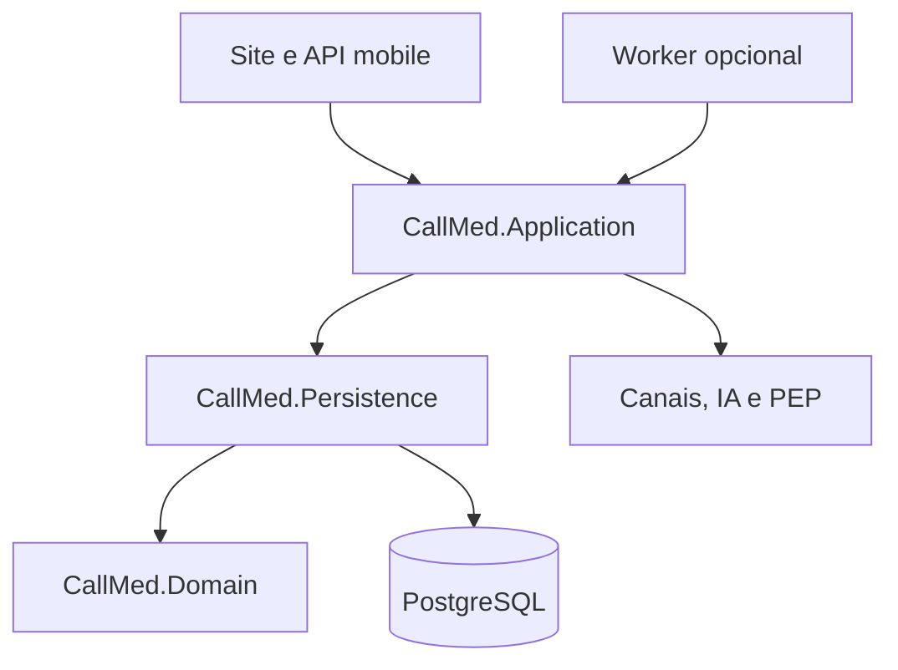

<p align="center"></p>
<h1 align="center">CallMed</h1>
<p align="center"><strong>Agenda, atendimento e jornada do paciente em conexão.</strong></p>
<p align="center">ASP.NET Core 10 · PostgreSQL · Razor · Android nativo · WebRTC</p>

A CallMed reúne o atendimento administrativo de clínicas multiprofissionais, o agendamento online e o acompanhamento da consulta. Pacientes acessam o site ou o aplicativo Android; profissionais, recepção e administração trabalham nas áreas correspondentes ao seu perfil.

A **V35** reorganiza a solução em projetos, remove o TWA e os materiais de entregas antigas, extrai regras compartilhadas e apresenta um visual novo com **um único CSS autoral**. A integração **httpSMS permanece preservada**.

## O que o sistema reúne

> **Novidade desta entrega SENAI:** Teleconsultas em destaque na navegação por perfil e no painel da recepção, junto de confirmações, fila inteligente e check-in. Guia: [`docs/senai/DESTAQUES-PRIORIDADES-DA-DEMANDA.md`](docs/senai/DESTAQUES-PRIORIDADES-DA-DEMANDA.md).


| Área | Recursos |
|---|---|
| Atendimento | Central com conversas por canal, equipe, assistente administrativo, rascunhos e avaliação. |
| Agenda | Disponibilidades, marcação, confirmação, cancelamento, reagendamento e exceções. |
| Encaixes | Fila de espera, ofertas com prazo e aceite de vagas. |
| Jornada | Pré-cadastro, preparação, check-in, chegada e etapas do atendimento. |
| Salas | Gestão de salas físicas e virtuais, bloqueios, reservas e presença na teleconsulta. |
| Conta | Dados, foto, preferências, segurança, sessões e pedidos de privacidade. |
| Gestão | Cadastros, convênios, exames, relatórios, indicadores e auditoria. |
| Integrações | Evolution/WhatsApp, httpSMS, Gmail API, SMTP, Gemini e API PEP/FHIR. |

A IA auxilia em tarefas administrativas e utiliza as regras do backend para alterações na agenda. A disponibilidade de cada canal depende da configuração dos seus provedores.

## Arquitetura



| Caminho | Responsabilidade |
|---|---|
| `src/CallMed.Web/` | MVC, Razor/Identity, APIs, webhooks, componentes e arquivos do site. |
| `src/CallMed.Domain/` | Entidades, tipos e validações compartilhadas. |
| `src/CallMed.Persistence/` | Contexto, mapeamentos EF Core e migrations. |
| `src/CallMed.Application/Modules/` | Funcionalidades organizadas por domínio de trabalho. |
| `src/CallMed.Application/Infrastructure/` | Implantação do banco, hospedagem e serviços compartilhados de infraestrutura. |
| `src/CallMed.Worker/` | Execução separada das rotinas automáticas. |
| `mobile/android/` | Aplicativo nativo de pacientes, em Kotlin e Jetpack Compose. |
| `tests/` | Verificações .NET/PostgreSQL, interface e roteiro de revisão local. |
| `scripts/` | Validação do CSS, referências, certificado e integração. |
| `infra/` | Modelos de variáveis do Render (`render/`) e Compose com Evolution (`evolution/`). |
| `docs/` | Documentação: arquitetura, implantação, funcionalidades, integrações, Android, SENAI e SQL. |

Consulte [a arquitetura completa](docs/ARQUITETURA.md) para dependências, limites e compatibilidade.

## Executar o site

Extraia a V35 em uma **pasta nova**, preservando suas configurações e chaves existentes separadamente. Use o SDK .NET indicado em `global.json` e um PostgreSQL dedicado ao ambiente.

```powershell
dotnet restore CallMed.sln
dotnet build CallMed.sln -c Release -m:1
dotnet run --project src/CallMed.Web
```

Configure as variáveis do ambiente a partir de `.env.example`. Os exemplos são modelos de configuração; o aplicativo recebe os valores pelo ambiente, pelo gerenciador de segredos ou pelo arquivo local de configuração apropriado. Não publique credenciais no Git.

## Publicar no Render

O Dockerfile padrão publica o site e seus projetos referenciados. O comando permanece `dotnet CallMedCrud.dll`. Quem já implantou a V34 pode manter suas variáveis: **a V35 não exige nova variável nem muda o schema 37**.

O modo padrão executa as rotinas dentro do site. A separação é opcional: `Dockerfile.worker` inicia o worker quando web e worker usam `Jobs__Mode=external`. Use um worker nesse desenho de implantação. Veja [a implantação](docs/IMPLANTACAO.md) e [o modelo de ambiente](infra/render/RENDER.env.example).

## Interface e acessibilidade

O site carrega somente `src/CallMed.Web/wwwroot/css/callmed.css`. Essa é a origem mantida, escrita para a V35; não é um bundle e não depende de CSS de versões anteriores. Faça alterações diretamente nela e execute:

```sh
python scripts/check-css.py
python scripts/auditar-views-callmed.py
```

A navegação principal permanece no topo. A Central mantém três colunas em telas amplas e alterna suas áreas no celular. Temas claro/escuro, foco visível, ampliação de texto, contraste e redução de movimento fazem parte da interface.

## Qualidade

```sh
dotnet run --project tests/CallMed.Checks -c Release
dotnet run --project tests/CallMed.Checks -c Release -- --architecture
dotnet run --project tests/CallMed.Checks -c Release -- --mobile
dotnet run --project tests/CallMed.Checks -c Release -- --salas
```

As suítes PostgreSQL exigem `CALLMED_TEST_DB` apontando para **um banco local isolado com nome iniciado por `callmed_test`**. Elas alteram e recriam seus dados de teste. Não use o banco da clínica. O workflow `CallMed quality` compila os projetos, executa as verificações e publica os artefatos de teste.

A fixture local `--salas-fixture` usa dados fictícios e não envia mensagens reais. Sua página `/fixture/review` permite revisar telas, temas, largura e ampliação com axe-core. Instale as dependências de `tests/browser` para utilizá-la. Essa página não existe no host de produção.

## Android

O APK nativo **34.0.0 / 3400** foi mantido, com a mesma assinatura e contrato de API. Ele continua distribuído em `/aplicativo`. A V35 altera a arquitetura do servidor e o visual do site; o app utiliza sua interface Compose própria. Abra `mobile/android` no Android Studio para trabalhar no aplicativo.

## Documentação

- [Arquitetura](docs/ARQUITETURA.md)
- [Implantação](docs/IMPLANTACAO.md)
- [httpSMS](docs/integracoes/HTTP-SMS.md)
- [Gmail API](docs/integracoes/GMAIL-API-RESPOSTAS-CENTRAL.md)
- [TURN/Metered](docs/integracoes/METERED-TURN.md)
- [Acessos da equipe](docs/funcionalidades/ACESSOS-DA-EQUIPE.md)
- [Android](docs/android/ANDROID-NATIVO.md)
- [Demanda SENAI](docs/senai/DESAFIO-SENAI.md)

Configuração de provedores reais, permissões do dispositivo e chamadas em redes distintas devem ser conferidas no ambiente da clínica.
