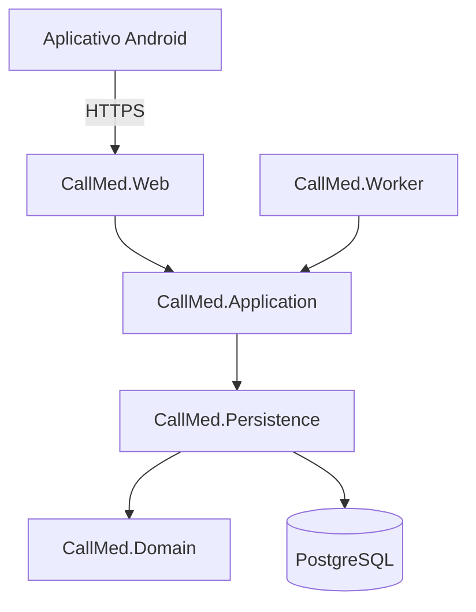

# Arquitetura do CallMed

O CallMed é um monólito modular com dois hosts .NET. O site expõe as páginas Razor, a API para Android e os webhooks. O worker pode executar as rotinas em segundo plano. Os dois usam a mesma aplicação e o mesmo banco PostgreSQL.

## Dependências entre os projetos

| Projeto | O que editar aqui |
|---|---|
| [Domain](../src/CallMed.Domain) | Entidades, enumerações, validações profissionais e contratos compartilhados. |
| [Persistence](../src/CallMed.Persistence) | Contexto do EF Core, mapeamento e migrations. |
| [Application](../src/CallMed.Application) | Regras de negócio em Modules, registro de dependências em Composition, rotinas em Jobs e inicialização em Infrastructure. |
| [Web](../src/CallMed.Web) | Controllers MVC, APIs, Razor, Identity, assets e download do APK. O assembly do host chama-se CallMedCrud.dll. |
| [Worker](../src/CallMed.Worker) | Inicialização do processo separado de rotinas. O modo padrão as executa no site. |

Os namespaces MKSANCrud existentes fazem parte do código compartilhado e podem ter nomes diferentes das pastas. Os dois hosts referenciam Application, que referencia Persistence. Domain inclui o modelo de usuário baseado no Identity.

## Onde alterar cada funcionalidade

| Funcionalidade | Regra ou integração | Apresentação ou entrada |
|---|---|---|
| Marcar ou remarcar | [Agendamento e disponibilidade](../src/CallMed.Application/Modules/Agenda/Agendamento) | [Formulário de consulta](../src/CallMed.Web/Views/Consulta/_Form.cshtml) |
| Confirmação e links da consulta | [Confirmações](../src/CallMed.Application/Modules/Agenda/Confirmacoes) | [Ações de consulta](../src/CallMed.Web/Controllers/Jornada/ConsultaAcaoController.cs) |
| Encaixe após cancelamento | [Fila de espera e notificações](../src/CallMed.Application/Modules/Agenda/FilaDeEspera) | [Telas de lista de espera](../src/CallMed.Web/Views/ListaEspera) |
| Central de atendimento | [Conversa](../src/CallMed.Application/Modules/Atendimento/Conversa), [orquestração](../src/CallMed.Application/Modules/Atendimento/Orquestracao) e [entrega](../src/CallMed.Application/Modules/Atendimento/Entrega) | [Central](../src/CallMed.Web/Views/Atendimento) |
| SMS, WhatsApp e e-mail | [Implementações dos canais](../src/CallMed.Application/Modules/Atendimento/Services/Canais) | [Webhooks](../src/CallMed.Web/Controllers/Api/AtendimentoWebhookController.cs) e [guias dos provedores](integracoes) |
| Assistente de IA | [Conversa e sessão](../src/CallMed.Application/Modules/Assistente/Conversa), [ferramentas](../src/CallMed.Application/Modules/Assistente/Ferramentas) e [prompts](../src/CallMed.Application/Modules/Assistente/Prompts) | [Controller do agente](../src/CallMed.Web/Controllers/Atendimento/AgenteController.cs) |
| Check-in e preparação | [Jornada](../src/CallMed.Application/Modules/Jornada) | [Telas da jornada](../src/CallMed.Web/Views/Jornada) |
| Salas e teleconsulta | [Acesso, presença e ICE](../src/CallMed.Application/Modules/Salas/Services) e [modelos de leitura](../src/CallMed.Application/Modules/Salas/ReadModels) | [Painel de salas](../src/CallMed.Web/Views/Salas), [sala web](../src/CallMed.Web/Views/Jornada/Tele.cshtml) e [vídeo no Android](../mobile/android/app/src/main/java/com/callmed/app/NativeTele.kt) |
| Conta e perfil | [Contas](../src/CallMed.Application/Modules/Contas) e [sessões do Android](../src/CallMed.Application/Modules/ContasMobile) | [Conta no site](../src/CallMed.Web/Controllers/Conta) e [API mobile](../src/CallMed.Web/Controllers/Mobile) |
| Interface do site | [Folha de estilos compartilhada](../src/CallMed.Web/wwwroot/css/callmed-clinic-r93.css) e [JavaScript por área](../src/CallMed.Web/wwwroot/js) | [Views Razor](../src/CallMed.Web/Views) e [páginas de identidade](../src/CallMed.Web/Areas/Identity) |

## Execução e distribuição

Jobs__Mode aceita embedded (padrão), external ou disabled. No modo external, o worker executa as rotinas e o site recebe as requisições. A migração do banco é um comando separado descrito em [implantação](IMPLANTACAO.md).

O site é publicado pelo Dockerfile da raiz. O Android consome a API mobile e usa WebRTC para vídeo. A assinatura do aplicativo ocorre na máquina que guarda a chave de lançamento. Os [arquivos de download](../src/CallMed.Web/App_Data/Aplicativo) e o [projeto Android](../mobile/android) têm finalidades distintas e seus números de versão podem diferir.
