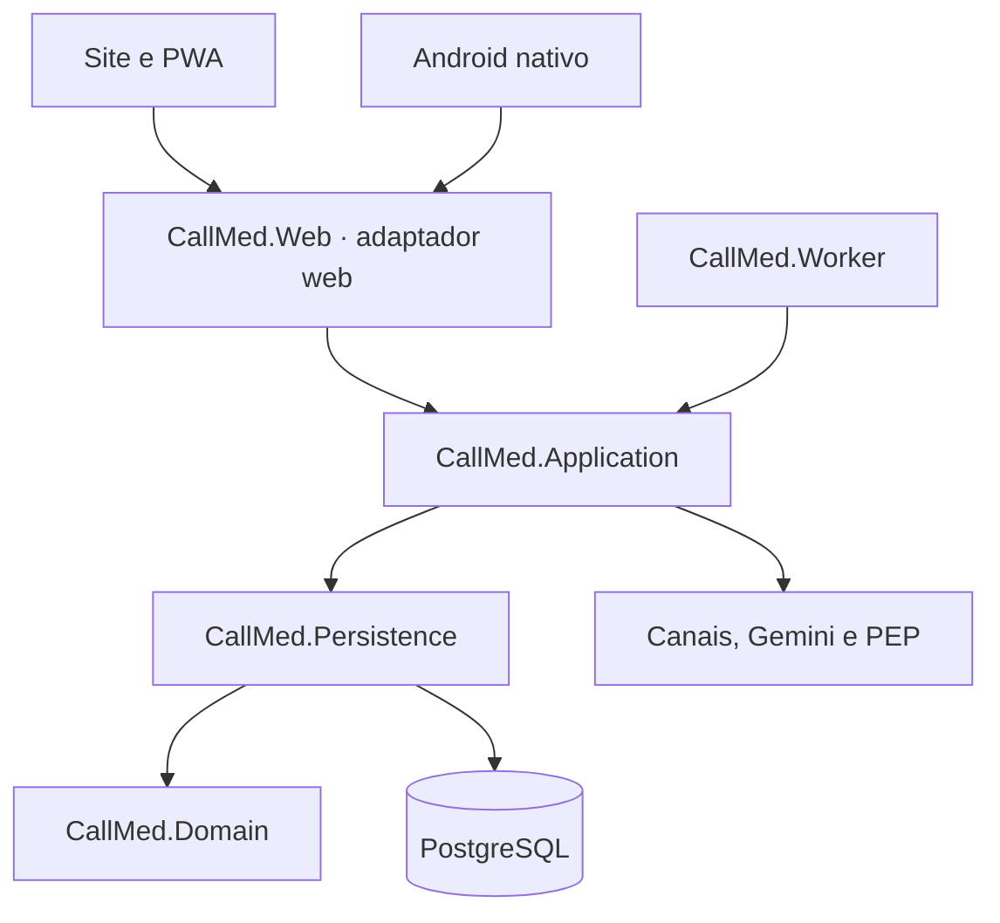

# Arquitetura CallMed V35

A solução é um monólito modular com cinco projetos de produção. A interface web e o worker têm processos de execução próprios; ambos utilizam o mesmo núcleo e o mesmo PostgreSQL. O modo padrão continua executando as rotinas dentro do site, preservando instalações existentes.

| Projeto | Responsabilidade |
|---|---|
| `src/CallMed.Domain` | Entidades, enumerações, constantes e validações de registro profissional. Mantém `Usuario : IdentityUser` por compatibilidade; não é um domínio totalmente independente de framework. |
| `src/CallMed.Persistence` | `MKSANContext`, configurações EF Core e migrations históricas. Não conhece controllers nem a aplicação web. |
| `src/CallMed.Application` | Módulos de negócio, casos de uso, consultas, contratos, integrações, configuração e registro de dependências. |
| `src/CallMed.Web` | Controllers MVC/mobile/webhooks, Razor/Identity, componentes, middleware, bootstrap e arquivos públicos. O executável permanece `CallMedCrud.dll`. |
| `src/CallMed.Worker` | Host das rotinas automáticas quando o modo externo é escolhido explicitamente. Não referencia o projeto web. |

## Módulos da aplicação

`Modules/` agrupa Agenda, Consultas, Atendimento, Assistente, Cadastros, Contas, ContasMobile, Jornada, Salas, Solicitações, Gestão, IntegraçãoPEP e Psicologia. `Infrastructure/` reúne banco, implantação, hospedagem e SMTP. `Composition/` registra as dependências; `Jobs/` reúne rotinas clínicas compartilhadas. Contratos e configurações dos canais ficam junto do módulo que os utiliza.

As listagens de consultas e pacientes foram retiradas dos controllers para consultas da aplicação. `ConsultaWorkflow` centraliza autorização, confirmação/cancelamento, atualização das solicitações vinculadas e auditoria para site e Android. O acesso de pacientes verifica vínculo e papel. As demais áreas mantêm suas verificações existentes; ainda há consultas EF em outros controllers, cuja migração pode ser feita por caso de uso.

Os serviços maiores da IA foram organizados em arquivos por responsabilidade: contexto, confirmação, respostas, sessão, identificação, pacientes, disponibilidade, consultas, espera e cadastro. Os arquivos parciais compartilham a mesma instância. O texto do prompt administrativo é um recurso incorporado separado do código que fornece suas variáveis; o conteúdo e as regras dos canais foram preservados.

## Rotinas e execução

| `Jobs__Mode` | Processo web | Worker separado |
|---|---|---|
| `embedded` ou ausente | Executa as dez rotinas, incluindo httpSMS | Recusa iniciar para evitar duplicação por configuração acidental |
| `external` | Atende páginas, APIs e webhooks | Executa as rotinas |
| `disabled` | Sem rotinas | Recusa iniciar |

O modo externo usa `Dockerfile.worker` e as mesmas configurações de banco, certificado e provedores. A implantação documentada é um web e um worker; não há um broker externo nem promessa de entrega exatamente uma vez. A persistência e os controles de repetição já existentes continuam aplicados. Inicialização do banco permanece um comando de implantação separado: `dotnet CallMedCrud.dll --migrate`.

## Interface

Todo o site utiliza exclusivamente `src/CallMed.Web/wwwroot/css/callmed.css`, uma folha escrita para a V35. Os 13 módulos antigos, o bundle anterior e o gerador foram removidos. Não há etapa de concatenação nem importação de CSS. `scripts/check-css.py` valida o contrato. Os nomes de classes usados pelo JavaScript foram preservados quando necessários ao comportamento.

Navegação superior, menus por tarefa, componentes comuns de formulário/tabela/status, temas claro e escuro, ampliação de texto, alto contraste, foco de teclado e redução de movimento compõem a base visual. A Central conserva três colunas em telas amplas e alterna conversas, chat e contexto no celular.

## Compatibilidade e limites

Os namespaces `MKSANCrud.*`, identificadores de entidades, nomes de tabelas e contratos HTTP foram mantidos. Os aliases de `Medico`/`Psicologo` ainda apontam para `ProfissionalSaude`; removê-los de forma indiscriminada quebraria o código e o histórico do banco. O schema continua 37. A integração httpSMS foi transferida de pasta sem reescrever seus arquivos; a validação da entrega compara os hashes com a V34. O APK nativo 34.0.0 foi preservado e continua usando a API existente.

O TWA, seus workflows e os rascunhos de publicação na loja foram removidos. Android App Links e a distribuição direta do APK continuam disponíveis. As opções antigas `Twa:*` permanecem apenas como aliases de configurações já implantadas.

## Revisão incremental de estrutura (branch de auditoria)

- **Apresentação:** login e cadastro continuam com visual V34, agora no CSS único de V35, isolado por `@scope (body.identity-body)`. O carregamento por condição foi retirado do `_DocumentHead`.
- **Controllers:** as ações de atendimento e consulta foram separadas em arquivos de classe `partial`; a interpretação de payload da Evolution também foi isolada em um arquivo parcial. As rotas, atributos de autorização e assinaturas dos métodos não mudam.
- **Encaixe:** a fase de notificação foi separada da seleção/reserva, sem mudança deliberada na lógica de concorrência ou envio do httpSMS. Futuras melhorias na reserva exigem testes reais de concorrência.
- **Contrato compartilhado:** `IClinicaClock` passou a viver em `CallMed.Domain/Contracts/`, mantendo o namespace para compatibilidade. `Application` continua referenciando `Persistence` — a arquitetura segue sendo um monólito modular, não Clean Architecture estrita.
- **Migração:** `DatabaseDeployment` continua validando `CallMedSchemaVersions` 37. Os inicializadores históricos são preservados; a revisão adicionou somente verificações estáticas do número e dos registros, não executou migrações em bancos de produção.
- **Distribuição:** o APK servido pelo site e os arquivos `mapping-*.txt.gz` históricos foram preservados por serem necessários para distribuição e diagnóstico de versões. Novos arquivos de build e mapas devem ser publicados como artefatos, fora do repositório, a partir da próxima versão.

Na CI, `python scripts/check-architecture.py` verifica referências entre projetos, contratos, estilo único, classes parciais e versão do schema. O build .NET e testes existentes permanecem obrigatórios antes de mesclar.
